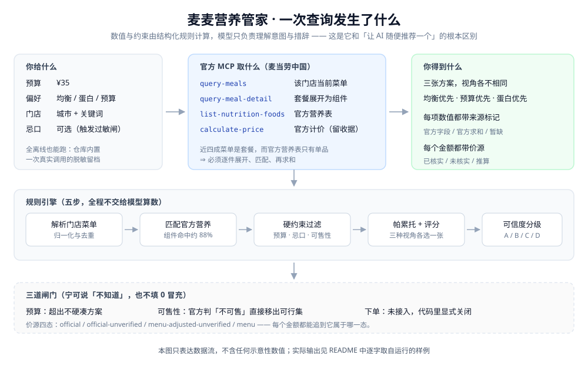
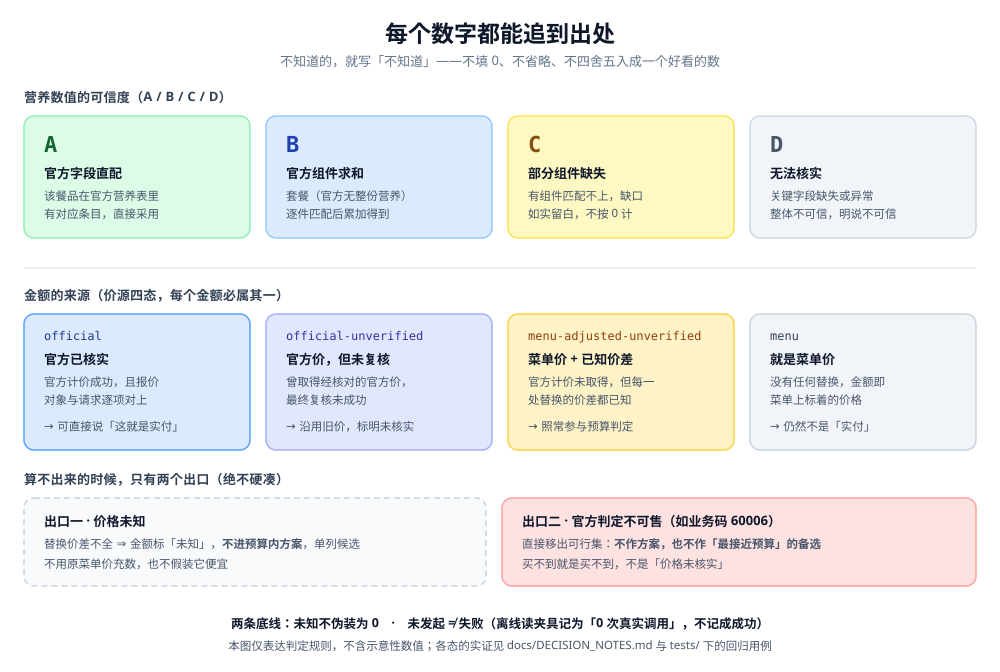

# 麦麦营养管家 · McMeal Compass

> **不替你定义健康，只帮你看清每一种搭配的营养与价格。**

基于**麦当劳中国官方 MCP**（Model Context Protocol）的「**可解释营养搭配 × 官方计价核价 × 下单前安全闸门**」命令行工具。

- **参赛项目：** 2026 麦当劳程序员创意开发大赛
- **项目性质：** 独立开发者参赛作品
- **状态（2026-10-19 更新 · 与实况对齐）**：**可运行 · 可装载 · v3.7.3 已获第三方签收**——
  解析 / 匹配 / 套餐展开 / 硬约束 / 评分 / 推荐 / 解释 / 可运行 CLI / **Skill 装载入口**（`SKILL.md`）
  均已就绪，**可离线复现（无需 Token）**；在线链路已有实测证据留档
  （`docs/API_PROBE_NOTES.md`、`scripts/independent-online-verify.mjs`，并已经外部复评独立在线复核）；
  **人工审核 35 条已逐条判定并结清**（2026-10-12，见 `docs/HUMAN_REVIEW.md`）。
  第三方复评的进度**按版本如实标注**：**v3.7.3 已签收**（2026-10-16）；此后 **v3.7.4 / v3.7.5 / v3.7.6
  均为维护与文档版**——分别修「`isDefault` 三态判据 / 文档路径门槛」「首屏状态对齐」「首屏加演示与图示」，
  **均不扩功能**，**待复评**；其中 **v3.7.5 已在 Releases 发布**。
  ⛔ **唯一被显式关闭的能力是「真实下单」**——`REAL_ORDERING_ENABLED = false`，**不提供、也不声称提供购买能力**。

> **30 秒上手（不需要 Token）**：`git clone` 后 `npm install && npm run demo`。
> 详见下方[「立刻试一下」](#立刻试一下不需要-token)，那里贴的是**逐字取自真实运行**的输出。

> ⚠️ **关于「实时价格」的准确说法**：官方计价**已接入**（`calculate-price`），每次报价都留结构化收据。
> **2026-10-14 已有真实门店的端到端案例**：四次真在线运行（门店 `3450024`）中，三张方案**均取得官方计价并核实**
> （每次 28 项候选取价全部成功、失败 0、重试 0），留档见 [`docs/demo/`](./docs/demo/README.md)。
> 但**仍局限于单门店、单时段**，**尚未**覆盖多门店/多时段的系统性复核。因此本项目**只承诺**
> 「能取到官方报价并如实标注来源与未核实项」，**不承诺**「价格闭环已在多场景验证完成」。
> 展示层凡未经官方核价的金额，一律标注**「未核实实付」**。

> ⚠️ **免责声明：** 本项目为独立开发者参赛作品，**不代表麦当劳官方出品、官方认证或合作关系**。项目输出仅供参考，**不构成医疗、营养或其他专业建议**；餐品信息、价格及供应状态以麦当劳官方渠道的实时结果为准。

---

## 这是什么？（15 秒速览）

想吃麦当劳时，不必在「好吃、省钱、符合自己的饮食目标」之间反复纠结：**输入预算和饮食偏好**，工具通过麦当劳官方 MCP 查询**该门店当前菜单**、**官方营养数据**，并尽力取官方计价，给出**有来源、可比较、可解释**的候选与取舍说明。


<sub>▲ 上面这一段是**逐字取自真实运行**的终端输出（离线复用已存快照，故屏幕里会如实提示「数据已超时效、仅作历史样例」）。只加了终端换行，未改一字、未补一个数。</sub>



> ⛔ **本版本不能下单**：`create-order` 未接入，**下单能力已在代码里显式关闭**
> （`REAL_ORDERING_ENABLED = false`，调用即抛 `ORDERING_DISABLED`）。
> 仓库里的下单闸门（`order-guard.ts`）是**为将来准备的**，它保证「未确认绝不执行」，
> 但**不表示**现在已经能买到东西——这是刻意的诚实，而非功能缺失的掩饰。

## 为什么值得看？

| 常规点餐推荐 | 本项目的差异化承诺 |
|---|---|
| 给出「推荐理由」，来源不明 | 每个数值标记「**官方字段 / 官方单品求和 / 暂缺**」，可展开溯源 |
| 一次输出一份所谓「最佳套餐」 | 显示**可比较的备选与取舍说明**，让你自己决定 |
| 只看静态营养表 | 与实际门店菜单、套餐替换规则交叉核对；计价**尽力取官方值**，取不到就标「未核实」 |
| 选择「少吃」和「低热量」 | 支持营养偏好与预算**共同优化**，不贬低食物、不使用外貌羞辱措辞 |
| 模型自说自话 | **结构化规则负责数值和约束，LLM 仅负责理解意图及清晰表达** |

## 能做什么

- **按真实门店选餐** —— 结合门店、时段与就餐方式（到店自取 / 外送）查询**当前可售**商品。
- **套餐自动展开取营养** —— 菜单近四成是套餐，而官方营养表只有单品；本项目经
  `query-meal-detail` 展开套餐、逐件匹配官方营养再求和（实测组件命中 **87.6%**）。
- **三方案对比** —— 「均衡优先 / 蛋白质优先 / 预算优先」三种不同目标的可行候选，附营养与价格差异；
  **`--priority` 决定首选是哪一张**（不是只印个标签）。
- **正餐范围可解释** —— 默认只把**正餐候选**纳入推荐（甜品/冰饮/饮品不计入），
  需要比较「单品/加餐」时显式开 `--scope all`。
- **配件替换对比** —— 在官方允许的替换范围内更换饮料/配菜，**营养与价格一并重算**
  （`--swap 轮次=选项`，如 `--swap 选择套餐内饮料=无糖可口可乐中杯`）。
  替换后的组成会**真的进入官方计价请求**（详见下方「价格随替换重算的确切边界」）。
  非法替换会被**拒绝并回列可用项**；**一次都没命中的替换也会如实报出原因**，绝不悄悄跳过。
  轮次名不唯一时（如同一套餐里有两个「小食」）**不替你猜**，而是要求用 `小食#2` 指定。
- **最终复核真执行** —— 对入选方案按**当下**再报一次价（含完整组成的指纹），变价即重算预算/评分/解释；
  复核后超预算的方案会被撤下，**不拿旧价充数**。
- **诚实的数据标注** —— 官方数据、组合加总、部分缺失、无法核实四级分层，**未知项绝不伪装为 0**；
  离线的真实请求数如实记为 **0**，夹具读取不会被写成一次成功的官方调用。

> **「价格随替换重算」的确切边界（2026-10-16 二次修正 · 复评 P1 整改）**
>
> | 场景 | 实发载荷 | 价格表现 |
> |---|---|---|
> | **未替换**（全默认项） | `items=[套餐码×1]` | 与既往一致，**官方核价覆盖面零回归** |
> | **在线 · 已替换** | `items=[套餐码×1]` ＋ **`roundList=[轮次id:选项code…]`** | 官方报价**真的随组成变化**（实测：同一套餐不含组成 5050 分 → 带 +¥2 选项 **5250 分**） |
> | **在线 · 官方判定不可售**（如 `60006`） | 同上报载荷 | **移出可行集**——不作方案、也不作「最接近预算」的备选。可售性已被官方否定，不是"实付未核实" |
> | **在线 · 可售性未知**（超时／限流／对象核对不上） | 同上报载荷 | 金额改为「**菜单价 ＋ 已知替换价差**」的**推算值**（价源 `menu-adjusted-unverified`），标明**不是实付、也未确认可售**；该金额**照常参与**预算判定（既不放过、也不放宽） |
> | **在线 · 替换价差不全** | 同上报载荷 | 按**价格未知**处理：`effectivePrice=null`，**不进预算内方案**，并单列为「价格未知候选」 |
> | **离线**（夹具） | 不发起计价 | 无替换＝菜单价；**有替换＝菜单价 ＋ 已知价差**（官方价差同样是数据，故推算同样成立） |
>
> **一句话原则**：**「这个价格没算替换价差」与「它在预算内」不能同时成立**——
> 要么把已知价差算进去再比，要么承认价格未知、不参与判定。
> 依据与实验记录见 [`docs/DECISION_NOTES.md`](./docs/DECISION_NOTES.md)「10-16 追加 · O9」、
> 「10-16 追加（晚间）· v3.7.1 复评整改」与「v3.7.3 复评 → v3.7.4 维护版」；
> 回归断言见 `tests/substitution-pricing.test.ts`（载荷必变、正负价差、四类失败口径、价差不全）。

## 立刻试一下（不需要 Token）

仓库内附有**一次真实调用的脱敏留档**（公开菜单与营养数据），clone 后即可运行：

```bash
npm install
npm run demo              # 门店营养速览
npm run recommend         # 三方案推荐（预算 ¥35）
```

**离线留档的真实输出（节选，逐字取自运行）**：

```text
门店    麦当劳重庆嘉年华餐厅（3450024）
数据    2026-10-10 20:08:57　·　离线夹具（无需 Token · 快照 baseline-20261010-3450024）
时效    ⚠️ 已超时效 1 小时——只能作历史样例，不代表当前可售，也不是实时价格
预算    ¥35.00　·　偏好 均衡优先　·　范围 正餐候选

【方案 1 · 均衡优先（首选）】
  名称    人气超值四件套随心选（套餐·4 项组成）
  实付    ¥28.00（菜单价，未核实实付）
  营养    1091 kcal　·　蛋白 38g　·　脂肪 46g　·　碳水 127g　·　钠 1710mg（可信度 B）
```

**同一工具在线跑（需 Token）**——价格来源会变成「**官方计价已核实**」：

```bash
export MCD_MCP_TOKEN=你的Token
node src/cli.ts --city 重庆市 --keyword 观音桥 --budget 35
```

```text
门店    麦当劳重庆嘉年华餐厅（3450024）
数据    2026-10-14T19:40:06+08:00　·　实时调用（mcd-mcp 1.0.0 · 协议 2025-06-18/legacy）

【方案 1 · 均衡优先（首选）】
  名称    双层深海鳕鱼堡（单品）
  实付    ¥25.50（官方计价已核实）
  营养    485 kcal　·　蛋白 28g　·　脂肪 21g　·　碳水 46g　·　钠 917mg（可信度 A）
```

> 以上两段**均逐字取自真实运行**（非手写示例）；完整留档、六份产物的 SHA-256 与**四次真在线运行**记录，
> 见 [`docs/demo/`](./docs/demo/README.md)。录屏脚本见 [`docs/DEMO_SCRIPT.md`](./docs/DEMO_SCRIPT.md)。

> 上例中「圆筒冰淇淋（¥5）」**不会**出现在默认输出里——它是加餐而非正餐；
> 需要比较单品/加餐时显式加 `--scope all`。

可用参数：

```bash
node src/cli.ts --offline --budget 35 --priority protein   # 决定首选：budget / protein / balance
node src/cli.ts --offline --budget 35 --scope all           # 纳入单品/加餐比较（默认 meal 正餐候选）
node src/cli.ts --offline --budget 35 --min-protein 25 --avoid-sugary
node src/cli.ts --offline --budget 35 --declared-allergy   # 触发安全闸
node src/cli.ts --offline --budget 35 --json                # 含分数据源新鲜度与报价收据
node src/cli.ts --offline --budget 80 --min-protein 35 --swap "选择套餐内饮料=无糖可口可乐中杯"  # 套餐内替换并重算
```

> **口径三条**（都可被复核）：
> 1. **最低蛋白 / 避糖等非价格条件先验**——价格下降、折扣回补、报价失败都**不能**绕过它们；
>    避糖按**实际选中的套餐组件**判定（成分无法核实时，不宣称「已满足避糖」）。
> 2. **价格同源**——预算判定、评分、帕累托与解释句统一使用**本轮实际采用的价**（官方实付优先；
>    拿不到就按「菜单价 ＋ **已知**替换价差」推算并明确标「未核实实付、未确认可售」；
>    **价差不全则视为价格未知，不参与判定**——绝不用未调整的菜单价冒充实付）。
> 3. **回执如实**——离线的真实请求数就是 **0**；夹具读取不会被写成一次成功的官方调用。

> **安全闸**：一旦声明过敏，首屏即出现「**无法保证任何组合对你安全**」——
> 本项目不掌握完整过敏原与交叉接触信息，绝不出「安全可食用」的结论。

在线模式（需自行申请 Token）：

```bash
export MCD_MCP_TOKEN=你的Token
node src/cli.ts --city 重庆市 --keyword 观音桥 --budget 35
```

## 如何使用

> 前置条件：你需要自行申请麦当劳中国官方 MCP Token。

1. 访问 [麦当劳 MCP 开放平台](https://open.mcd.cn/mcp)，用手机号登录并**申请自己的 MCP Token**（详见[官方接入指南](https://github.com/M-China/mcd-mcp-server)）。
2. 在支持 **Streamable HTTP** 的 MCP 客户端（WorkBuddy / Cherry Studio / Cursor / Trae / Kiro / VSCode 等）中，按 [`mcp-config.example.json`](./mcp-config.example.json) 配置 `mcd-mcp` 服务，**将 `YOUR_MCP_TOKEN` 替换为你自己的 Token**。
3. 在客户端中启用 `mcd-mcp`，打开本 Skill，用自然语言描述你的一餐需求。例如：

   > 「预算 35 元，想补充蛋白质，不太想喝含糖饮料，附近门店午餐能买到什么？」

4. 按提示选择门店/就餐方式 → 查看三方案对比 → 需要时替换配件 → 核对结果。

   ⛔ **本版本不存在「下单」这一步**：`create-order` 未接入，下单被显式关闭。
   要开启，须先补齐请求幂等键、订单状态机（DRAFT→PRICED→USER_REVIEW→USER_CONFIRMED→SUBMITTING→SUCCEEDED/FAILED）、
   报价二次校验与重复提交防护。详见 `src/order-guard.ts` 文件头。

## 数据边界与限制（请务必阅读）

- **不做医疗推荐**：对疾病治疗、处方饮食、进食障碍、高风险限食、孕幼儿特殊营养等，只提供有来源的餐品基础信息，并建议咨询专业人士。
- **不保证过敏安全**：官方营养列表**不等同于完整过敏原/交叉接触数据库**；缺少经核实的过敏原信息时，我们**明确说无法保证安全**，绝不承诺「完全不含」。
- **不给「精确到个位数热量」的保证**：配料特制、份量波动、营养覆盖范围均可能造成差异；展示数据时标明「官方单品数据 / 组合计算值」及其条件。
- **不臆断可下单状态**：对未核实门店、营业时间与套餐结构，不做「已可下单」的断言。
- **本版本不下单**：下单链路未实现且被显式关闭（`ORDERING_DISABLED`）——**不提供、也不声称提供**购买能力。
- **不把「排序偏好」当处方**：「均衡优先 / 蛋白质优先 / 预算优先」是**排序偏好（启发式）**，
  用于在你给的条件下排出次序，**不是**营养处方或医疗建议，也未经临床验证。
- **不把菜单价当实付价，也不拿未调整的菜单价过硬预算**：官方计价未取得（或响应与请求的商品/数量核对不上）时，
  金额一律标注「**未核实实付**」，理由句中也不会出现「实付最低」这类未证实的说法。
  价格来源为**四态**：`official`（本次已核实）／`official-unverified`（沿用初次官方报价但**最终复核未成功**——
  明写"未核实，不代表当前实付"）／`menu-adjusted-unverified`（**菜单价 ＋ 已知替换价差**的推算值，
  标明"不是实付、也未确认可售"）／`menu`（菜单价）；**只有第一种**允许出现「已核」措辞。
  替换后若**任一价差缺失**，则视为**价格未知**、不进预算内方案；官方判定**不可售**者直接移出可行集。
- **不对没有目标的热量作优劣判断**：未给出热量目标时，对比句只报数值差，不写「此项更优」。
- **数据时效分开记账**：菜单 / 营养 / 套餐 / 价格各有自己的产生时刻与 TTL（价格 10 分钟，
  与下单闸门一致），过期一律**只能作历史样例**；未来时间戳判为不可信，不按「更新鲜」处理。

## 数据可信度分层

| 等级 | 判定 | 对外展示 |
|---|---|---|
| **A：官方单品** | 与官方营养记录**精确直配**（按官方 code 映射或名称精确命中），营养字段**完整**，且**不含推断** | 展示官方单品营养数据 |
| **B：可追溯组合** | 组合求和（套餐逐项展开），**或**含推断/别名/份量匹配 | 展示「基于官方单品数据求和」，可展开组成 |
| **C：部分可知** | 子项有缺失 / 配料变化无法量化 | 展示已知与未知项目，**不显示完整总量** |
| **D：无法验证** | 名称匹配不可靠、菜单/营养数据不可用 | 不输出具体营养数字；可查看菜单但不给「营养达标」结论 |



> **判定实现**：`matching.ts::assignConfidence()`。**A 为最高档且真可达**——
> 修前写作 `hasComposition ? 'A' : 'B'`，而单品调用恒传 `false`，故 A 对单品**永远不可达**
> （文档却写着「A 官方单品」，属**文档与实现背离**）。v3.6 按甲案修正：精确直配、完整、无推断 ⇒ **A**；
> 组合求和与含推断者 ⇒ **B**。可达性由 `tests/v36-a-level.test.ts` 断言（含「快照内 A 级数 > 0 且全为单品」）。

## 项目结构

```text
mcmeal-compass/
├── README.md                    # 本文件
├── SKILL.md                     # 可安装入口（Agent 装载用：用法 / 输出约定 / 边界）
├── CONTEST_DECLARATION.md       # 官方参赛声明（原样，未修改）
├── MCP_INTEGRATION.md           # 实测工具、调用证据与失败降级
├── mcp-config.example.json      # 脱敏配置示例（环境变量占位符）
├── workbuddy.md                 # WorkBuddy 开发上下文（申领专项奖励时提交）
├── package.json / tsconfig.json # 工程配置（Node ≥ 22.6，原生 TypeScript）
├── LICENSE
├── .gitignore
├── docs/                        # 架构、数据政策、隐私与安全、演示与审核留档
│   ├── API_PROBE_NOTES.md       # MCP 接口实测口径（35 工具、TOON 三坑、计价单位）
│   ├── MATCHING_NOTES.md        # 营养匹配实测（命中率、失败模式、别名取舍）
│   ├── DECISION_NOTES.md        # 决策内核口径（硬约束 / 评分 / 三方案 / 解释边界 / Go-No-Go 判定）
│   ├── RETROSPECTIVE-*.md       # 阶段复盘（远观法）
│   ├── HUMAN_REVIEW.md          # 人工审核口径与结论（35 条，2026-10-12 结清）
│   ├── human-review/            # 人工审核判定表与留档（含改前原件；见其 README 的身份对照表）
│   ├── DEMO_SCRIPT.md           # 演示录制脚本（真在线取材、分镜、遮挡要点、复核清单）
│   ├── demo/                    # 演示取材留档（真实运行原文 + SHA-256；见其 README）
│   ├── REVIEW-DISPOSITION-*.md  # 外部评审的逐条处置（取证 + 裁定）
│   └── REVIEW-RESPONSE-v3-*.md  # v3 整改的逐条对账（问题反例→修改→入口→日志→适用范围）
├── fixtures/                    # 不可变快照（测试基线的唯一来源，契约见 fixtures/README.md）
│   └── baseline-20261010-3450024/   # 一次真实调用的冻结：含 manifest.json（SHA-256 + 条数）
├── src/                         # 核心实现
│   ├── toon.ts                  # TOON 解析器 + MCP 返回包拆解
│   ├── money.ts                 # 金额契约（内部一律整数「分」）
│   ├── schema.ts                # 统一类型契约（zod）
│   ├── matching.ts              # 营养匹配（六级优先级 + 可信度分层 + 份量维度）
│   ├── aliases.ts               # 人工别名表（含风险标注）
│   ├── decompose.ts             # 套餐展开与替换校验（缺失不补零、非法替换必拒、**按名称解析替换**）
│   ├── analyze.ts               # 营养分析统一入口（单品直配 / 套餐展开收口 + 组件结构化留存 + 替换报告）
│   ├── detail-loader.ts         # 套餐详情加载器（失败**抛出原始错误** + 成功/失败两态缓存）
│   ├── validate.ts              # kJ/kcal 换算一致性校验（异常即降级，不入完整推荐）
│   ├── freshness.ts             # 数据新鲜度 TTL（分数据源；过期只能作历史样例）
│   ├── capture-guard.ts         # 采集写入保护（大小写/前缀绕过与覆盖防护）
│   ├── mcp-client.ts            # MCP 客户端（错误分类 + 有界退避 + Token 脱敏 + 分层验证）
│   ├── order-guard.ts           # 下单安全闸门（未确认绝不执行）
│   ├── constraints.ts           # 硬约束过滤（非价格条件先验 + 避糖三态判定 + 正餐范围）
│   ├── score.ts                 # 帕累托前沿 + 多目标评分（价格口径可注入，与判定同源）
│   ├── pricing.ts               # 计价闭环 + 报价对象核对 + 最终复核 + 收据统计
│   ├── recommend.ts             # 三方案生成与去重 + 偏好决定首选 + 最终复核接线
│   ├── explain.ts               # 证据驱动解释（X/Y 由程序算；热量无目标不判优劣）
│   ├── fixtures.ts              # 离线夹具加载（无 Token 也能演示；分数据源时刻）
│   └── cli.ts                   # 命令行入口（概览 / 推荐；--scope、--swap、JSON 新鲜度与替换报告）
├── scripts/                     # 可复现的开发工具
│   ├── measure-matching.ts      # 匹配质量量尺（离线，读快照）
│   ├── fixture-manifest.ts      # 快照 manifest 生成/校验（离线，复现门槛）
│   ├── propose-aliases.ts       # 别名候选提案（离线，只提案不落库）
│   ├── check-combo-decomposition.ts  # 套餐展开验证（在线，需 Token）
│   ├── capture-fixtures.ts      # 采集（写 work/captures/，**不碰** fixtures/；在线，需 Token）
│   ├── secrets-scan.mjs         # 凭据扫描（工作树 + git 历史；白名单排除占位/测试假值）
│   ├── check-placeholders.mjs   # 占位字样与非法时间戳检查（可 --dir 追加扫描待打包目录）
│   ├── sync-version.mjs         # **版本唯一源**同步：由 package.json 生成 src/version.ts（--check 并入 gate）
│   ├── source-identity.mjs      # **源码身份材料**：git bundle + tree id + 逐文件 blob/sha256 清单（交付用，只读仓库）
│   └── independent-online-verify.mjs  # 独立在线复核（串行低负载；仓库与交付包根目录均可直接运行）
└── tests/                       # 单元测试（node:test，**359 个用例**）
    ├── v3-acceptance.test.ts    # v3 验收要求（R1–R10，**只可迁移、不可删改**）
    ├── v3-probe-regression.test.ts  # v3 复审探针 R11–R13 回归（首选元数据/来源口径/失败收据）
    ├── v33-review-regression.test.ts # v3.2 复评回归（详情错误透传/混合轮次主件/禁止合成 live 成功）
    ├── v34-review-regression.test.ts # v3.3 复评回归（时区推断/D 级分层再分/别名边界）
    ├── v36-a-level.test.ts        # v3.6 甲案：A 级可达性（精确直配/含推断不升 A/组合归 B）
    ├── v361-api-consistency.test.ts  # v3.6.1：匹配器与分析层的 A/B 口径一致（含职责边界）
    ├── v362-reallimit.test.ts    # v3.6.2：真实限流形态（HTTP 200 + 业务码 508）与业务层有界重试
    ├── combo-substitution.test.ts  # 2026-10-16：套餐内替换（`--swap`）名称解析·歧义拒绝·端到端重算·CLI fail-closed
    ├── substitution-pricing.test.ts # 2026-10-16：替换的**价格链路**（载荷必变·正负价差·四类失败口径·价差不全）
    └── version-identity.test.ts   # 2026-10-16：版本身份（唯一版本源；抓 initialize 与 modern `_meta` 的真实请求体）
```

## 开发与测试

> 需要 **Node ≥ 22.6**（依赖原生 TypeScript 支持，无需构建步骤）。

```bash
npm install
npm run gate        # ⭐ 一条命令走完复现门槛：夹具校验 → 测试 → 类型 → 离线可跑
npm test            # 单元测试（解析 / 金额 / 契约 / 匹配 / 展开 / 分析 / 安全 / 决策 / CLI / 夹具）
npm run typecheck   # TypeScript 类型检查
npm run demo        # 离线演示：门店营养速览（不需要 Token）
npm run recommend   # 离线演示：三方案推荐（不需要 Token）
npm run measure     # 匹配质量量尺（离线，读 fixtures/ 快照）
npm run verify:fixtures  # 校验快照与 manifest 的 SHA-256 / 条数是否一致
npm run propose     # 别名候选提案（离线，只提案不落库，供人工审核）
npm run check:combo # 套餐展开验证（在线，需先配好 MCP Token）
npm run cli -- --variant 薯条=中   # 显式指定份量/口味（歧义项必须由你指定，我们不猜）
npm run capture     # 采集新数据 → work/captures/（在线，需 Token；**不会**改动测试基线）
```

> **测试基线是冻结的**：测试只读 `fixtures/<快照>/`，且逐文件校验 SHA-256；
> 采集脚本**永不**写入 `fixtures/`。若要换数据，须按 `fixtures/README.md` 显式新建快照并同步更新断言。

**人工审核（计划书 §11.2）**：抽样 **35 条已逐条判定并结清**（2026-10-12 逐行确认）——
判定表与留档见 `docs/human-review/`（`human-review-samples-filled.csv` 及**改前原件**、
按 v3.4 分层的重分类表、汇总脚本输出），口径、分层精确率与「无法判」构成见 `docs/HUMAN_REVIEW.md`。
3 条误配**已落地为规则修正 + 回归测试**；「机器主动拒绝」的条目单列，**不计入精确率分母**。
**只对「可判定项」声称精确率**，不对拒绝行为声称准确。

**测试与计划书 §11.1 的对应**：`tests/security.test.ts` 按编号覆盖
T02（401 不泄 Token）/ T03（429 有界退避）/ T11（未确认不下单）/ T12（计价单位）/ T15（无敏感信息）。

**实测口径**（详见 `docs/API_PROBE_NOTES.md`）：MCP 端点 `https://mcp.mcd.cn`（根路径）、共 35 个工具；
返回为「文档说明 + 原始 JSON」混合文本；**计价金额单位为「分」**（`3800` = ¥38.00）。

## 协议兼容（MCP）

| 时代 | 版本 | 本客户端行为 | 状态 |
|---|---|---|---|
| **legacy**（握手时代） | `2025-11-25` 及更早，默认 `2025-06-18` | `initialize` → `notifications/initialized` → 业务请求；若服务端下发 `Mcp-Session-Id` 则**回传** | ✅ **对 `mcp.mcd.cn` 实测可用**（35 工具枚举、在线采集均成功） |
| **modern**（无握手） | `2026-07-28` 起 | 不发握手；每请求带 `MCP-Protocol-Version` / `Mcp-Method` / `Mcp-Name` 头与 `_meta`（含 clientInfo/能力）；能力探测走可选 `server/discover` | ✅ 已实现，**用本地 fake server 测过**；**未对真实端点验证**（端点是否支持 modern 尚未核实） |

两条响应路径都支持：**JSON 直返** 与 **SSE（`text/event-stream`）**；响应 id 不匹配即判结构异常；
遇 `UnsupportedProtocolVersionError`（`-32022`）会报出服务端支持的版本。
集成测试见 `tests/protocol.test.ts`（11 个用例：JSON / SSE / 401·429·5xx / 版本不匹配 / modern 形态）。

> **兼容范围声明**：本项目**只声明**「已针对 `mcp.mcd.cn` 的 legacy 路径做过真实调用验证」；
> modern 路径为按规范实现并有本地集成测试，**未经真实端点验证**。

## 隐私与安全

- **不上传、不记录你的 Token**：`.env` 与私有配置已加入 `.gitignore`，仓库内仅保留环境变量占位符。
- **隐私最小化**：不收集姓名、手机号、精确收货地址、病史作为推荐的默认条件。

## 许可

见 [LICENSE](./LICENSE)。
